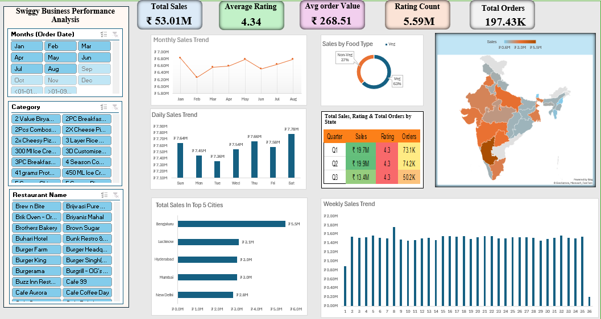

# 📊 Swiggy Business Performance Analysis

An interactive Business Intelligence Dashboard developed using **Microsoft Excel** to analyze Swiggy's business performance, sales trends, customer ratings, food categories, and geographical performance across India.

## 📌 Project Overview

This project focuses on analyzing Swiggy business data and transforming raw data into meaningful business insights through an interactive Excel dashboard.

The dashboard helps understand sales performance, order trends, customer ratings, and restaurant performance.

## 🛠️ Tools & Technologies

- Microsoft Excel
- Power Query
- Pivot Tables
- Pivot Charts
- Slicers
- Data Cleaning
- Data Visualization

## 📈 Key Performance Indicators (KPIs)

- **Total Sales:** ₹53.01M
- **Average Rating:** 4.34
- **Average Order Value:** ₹268.51
- **Rating Count:** 5.59M
- **Total Orders:** 197.43K

## 📊 Dashboard Features

- Monthly Sales Trend
- Daily Sales Analysis
- Weekly Sales Trend
- Sales by Food Type
- Total Sales by Top 5 Cities
- State-wise Sales Analysis
- Quarterly Sales, Ratings & Orders
- Interactive Month, Category, and Restaurant Filters

## 🎯 Key Objectives

- Analyze overall business performance.
- Identify sales trends across different periods.
- Understand customer ratings and order patterns.
- Compare sales performance across cities and states.
- Build an interactive dashboard for business decision-making.

## 📷 Dashboard Preview

## 👨‍💻 Author

**Om Wakchaure**

Artificial Intelligence & Data Science Engineering Student

[GitHub](https://github.com/)
